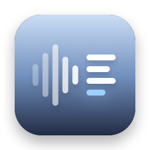
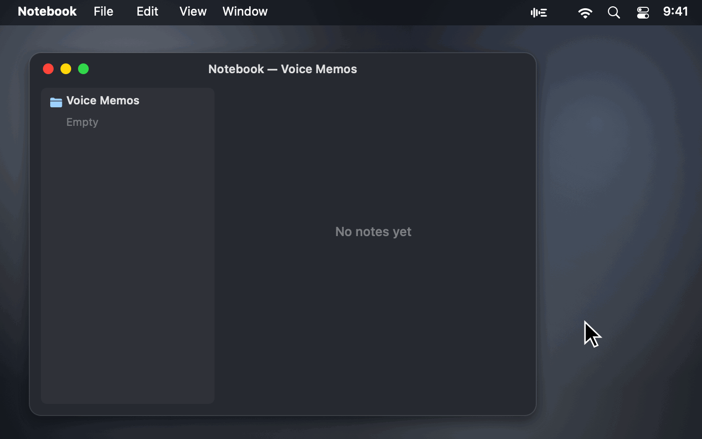
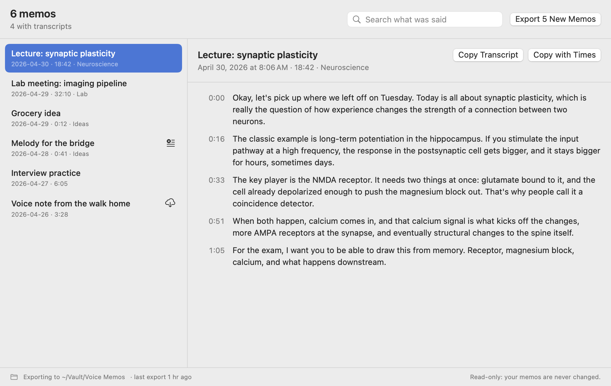
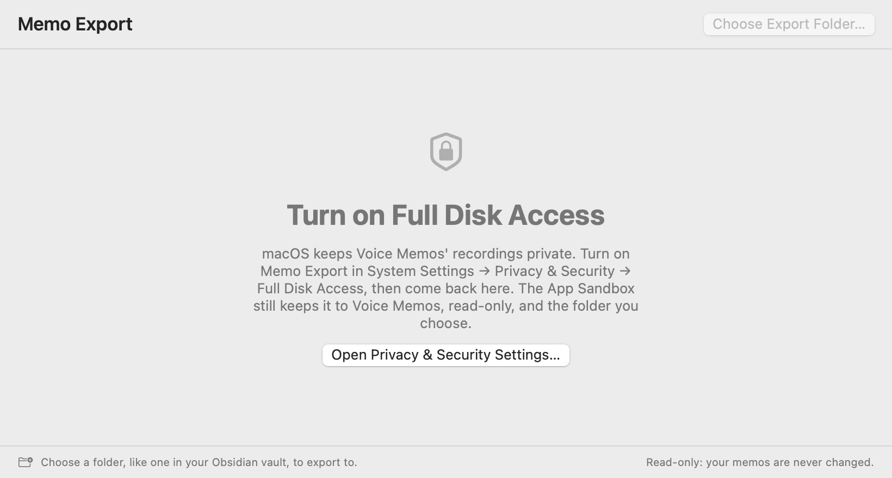

<p align="center">
  
</p>

<h1 align="center">Memo Export</h1>

<p align="center">
  <b>Your Voice Memos transcripts, as Markdown with the audio.</b><br>
  A free, open-source menu bar app that exports every Voice Memos recording as an audio file and a note with its timestamped transcript, ready for Obsidian or any notes app.
</p>

<p align="center">
  <a href="https://github.com/stanczykwyatt/memo-export/releases/latest/download/Memo-Export.zip"><b>Download for Mac</b></a>
  &nbsp;·&nbsp;
  <a href="https://stanczykwyatt.github.io/memo-export/">Website</a>
  &nbsp;·&nbsp;
  <a href="https://github.com/users/stanczykwyatt/projects/1">Roadmap</a>
  &nbsp;·&nbsp;
  <a href="https://github.com/stanczykwyatt/memo-export/discussions">Discussions</a>
</p>

<p align="center">
  <a href="https://github.com/stanczykwyatt/memo-export/actions/workflows/ci.yml"></a>
  <a href="https://github.com/stanczykwyatt/memo-export/releases/latest"></a>
  
  
  
  
  <a href="LICENSE"></a>
</p>

<p align="center">
  
</p>

---

Voice Memos on the Mac transcribes your recordings, which is great for lectures, meetings and ideas you talk through on a walk. Getting the words out is harder. You can copy a transcript one memo at a time, and the line breaks don't come with it. There's no export and no way to search what you said across memos.

Memo Export fixes that. Pick a folder, like one in your Obsidian vault, and every memo lands there as its `.m4a` plus a Markdown note: the title, date, length and Voice Memos folder, then the transcript in paragraphs, each starting with when it was said. Run it again and only new memos are added. Turn on automatic export and new recordings show up in your notes a few minutes after you make them, including ones synced from your iPhone.

It only reads Voice Memos, never changes it, and has no internet access. It's open source, so you can check exactly what it does.

If it saves you some copying, [starring the repo](https://github.com/stanczykwyatt/memo-export/stargazers) helps other people find it.

<picture>
  <source media="(prefers-color-scheme: dark)" srcset="docs/screenshot-dark.png">
  
</picture>

## Features

- **Export every memo** as its audio and a Markdown note with the whole transcript, in paragraphs with timestamps. A new paragraph starts wherever you paused, so a long lecture doesn't come out as one wall of text.
- **Only new memos on each run.** A small record in the export folder remembers what's there, so nothing is duplicated.
- **Never overwrites your edits.** If a transcript wasn't ready the first time, or you rename a memo, the note is updated, but only if you haven't edited it. Notes you edit or delete are left alone.
- **Automatic export,** off until you turn it on: new memos are exported a few minutes after they appear.
- **Obsidian-friendly.** Front matter with title, date, duration, folder and tags, and an `![[audio]]` embed Obsidian plays inline. Or standard Markdown links for any other app.
- **Search what was said** across every memo, with the matching words highlighted.
- **Copy a transcript with its paragraphs,** with or without timestamps, which copying from Voice Memos loses.
- **Optional SRT subtitles** for each memo, and optional subfolders matching your Voice Memos folders.
- **A command line tool,** `memo-export`, for scripts and Shortcuts.
- **Read-only and offline.** Free, with no account, subscription, tracking or dependencies.

### What a note looks like

```markdown
---
title: "Lecture: synaptic plasticity"
date: 2026-04-30T09:41:00-05:00
duration: "18:42"
folder: "Neuroscience"
audio: "2026-04-30 Lecture synaptic plasticity.m4a"
language: "en_US"
source: Voice Memos
voice-memo-id: "8C1F2A9E-…"
tags:
  - voice-memo
---

# Lecture: synaptic plasticity

Thursday, April 30, 2026 at 9:41 AM · 18:42 · Neuroscience

![[2026-04-30 Lecture synaptic plasticity.m4a]]

**0:00** Okay, let's pick up where we left off on Tuesday. Today is all about synaptic plasticity…

**0:16** The classic example is long-term potentiation in the hippocampus…
```

Files are named with the date first, so they sort in the order you recorded them.

## Install

> **Tested so far:** the export code has been run against a real Voice Memos library from the command line tool and from a sandboxed test build with the app's exact permissions. The signed app itself hasn't been tried with Full Disk Access turned on yet. If something doesn't work, please [open an issue](https://github.com/stanczykwyatt/memo-export/issues).

1. [Download **Memo-Export.zip**](https://github.com/stanczykwyatt/memo-export/releases/latest/download/Memo-Export.zip) and unzip it.
2. Move **Memo Export** to your Applications folder and open it.
3. Turn on Full Disk Access when it asks: **System Settings → Privacy & Security → Full Disk Access**, then switch on Memo Export. The window has a button that opens the right page.
4. Choose **Export Folder…** from its menu bar icon.



> **Why Full Disk Access?** macOS keeps Voice Memos' recordings in a protected folder that no other app can read without it. Memo Export's App Sandbox still limits it to that one folder, read-only, plus the export folder you choose. The rest of your disk stays out of reach even with Full Disk Access on. [SECURITY.md](SECURITY.md) has the details.

> **About the security warning:** The first time you open Memo Export, macOS may say Apple couldn't verify that it's free of malware. It shows up because the app isn't notarized yet: Apple charges developers $99 a year for that, and this project hasn't paid the fee. The code is fully open source, so you can read every line or build the app yourself. To open it, go to **System Settings → Privacy & Security** and click **Open Anyway**.

> **After an update:** turn Full Disk Access on again for the new version in **System Settings → Privacy & Security → Full Disk Access**. macOS ties the permission to each exact build, which keeps any other program from borrowing it.

> **Can't see the icon?** On a MacBook with a camera notch, menu bar icons that don't fit are hidden behind it. Hold ⌘ and drag the icon to the right, or quit a menu bar app you don't need.

### Build from source

You need macOS 14 or later and Swift 6, which comes with Xcode 16 or the Command Line Tools.

```bash
git clone https://github.com/stanczykwyatt/memo-export.git
cd memo-export
scripts/build-app.sh
open "build/Memo Export.app"
```

That also builds the command line tool as `build/memo-export`.

## How to use it

| To | Do this |
|---|---|
| Export what's new | Menu → Export New Memos (⌘E) |
| Export new memos as they appear | Menu → Export New Memos Automatically |
| Find a memo by what was said | Menu → Open Memo Export…, then type in the search field |
| Copy one transcript | Open Memo Export…, pick the memo, Copy Transcript or Copy with Times |
| Choose what's exported | Menu → Export Options: audio, SRT subtitles, folders, link style |
| Change the export folder | Menu → Export Folder → Choose Another Folder… |
| Stop it opening at login | Menu → turn off Open at Login |

A memo with no transcript gets a note saying so. Open the recording in Voice Memos and click the transcript button, and the next export adds the words. A memo synced from your iPhone but not downloaded to this Mac yet waits until it is. If you trim a recording after it's been exported, its note is updated but the exported audio stays as it was, since Memo Export never replaces a file it has already written.

### The command line tool

```bash
memo-export list                         # every memo, newest first
memo-export show "Lab meeting" --text    # one transcript, a paragraph per line
memo-export export ~/Notes/Voice\ Memos --srt
```

`memo-export --help` lists every option. It needs Full Disk Access for your terminal app, and like the app, it only reads Voice Memos and only writes into the folder you give it.

## Privacy and security

Memo Export is built so it *can't* misuse your memos, not just so it promises not to.

- **Read-only.** The App Sandbox gives it read access to the Voice Memos library and nothing else in your home folder, and blocks writing there. It never opens Voice Memos' database directly: it reads a copy in its own temporary folder, so it can't disturb Voice Memos even by accident.
- **Writes only where you say.** The one folder you choose, through the standard macOS folder picker. Files that are already there are never overwritten, and it never deletes anything.
- **No internet access.** The app has no network entitlement, so it can't send anything anywhere. CI checks every build for this.
- **No transcription of its own.** The transcripts are the ones Voice Memos already made on your Mac. Memo Export doesn't send your audio anywhere to be transcribed.
- **No dependencies.** Every line that runs is in this repository.

Check the app's permissions yourself with `codesign -d --entitlements - "/Applications/Memo Export.app"`. The full details are in [SECURITY.md](SECURITY.md).

## FAQ

**How do I export a transcript from Voice Memos on a Mac?**
Voice Memos only lets you copy a transcript one memo at a time, without its line breaks. Memo Export exports all of them at once, each as a Markdown note in paragraphs with timestamps, next to the audio.

**Can I export Voice Memos transcripts to Obsidian?**
Yes. Choose a folder inside your vault. Each note has front matter Obsidian reads as properties, a `voice-memo` tag, and an embed that plays the audio inside the note.

**Does it transcribe recordings that don't have a transcript?**
No. It exports the transcripts Voice Memos makes on your Mac, which needs macOS 14 Sonoma or later and a language Voice Memos supports. A memo without one is still exported with its audio, and its note gets the words once Voice Memos has made them.

**Does it work with memos from my iPhone?**
Yes, when Voice Memos syncs with iCloud on your Mac. Memos made on your iPhone show up once they've downloaded.

**Will it change or delete my memos?**
No. The App Sandbox only lets it read Voice Memos' folder, and it reads a copy of the database rather than the database itself. Deleting a memo in Voice Memos doesn't delete its exported note either.

**Can I edit the notes it makes?**
Yes. A note you've changed is never overwritten. Memo Export only updates a note it made and you haven't touched, like when a transcript arrives later.

**What are `.memo-export.json` and `.memo-export.lock`?**
The first is Memo Export's record of what it has exported to the folder, so each run only adds what's new. The second is empty and keeps two exports into the same folder from running at once. Both are hidden. If the record gets lost, Memo Export recognizes the notes already there and doesn't export them twice.

**Does it work on Intel Macs?**
Yes. The download runs on Apple silicon and Intel Macs with macOS 14 Sonoma or later.

## More free tools

**Mac apps**

- **[Show Desktop](https://github.com/stanczykwyatt/show-desktop):** hide every window with one click or ⌃⇧D, then bring them all back exactly as they were.
- **[Copy 2FA](https://github.com/stanczykwyatt/copy-2fa):** copy 2FA codes from Mail, Messages or a built-in authenticator with one keyboard shortcut.
- **[Who Stole My Focus](https://github.com/stanczykwyatt/who-stole-my-focus):** find out which app keeps jumping in front of your work.
- **[AI Footprint](https://github.com/stanczykwyatt/ai-footprint):** see what AI coding tools leave on your Mac, and what each update changed.
- **[Podcast Export](https://github.com/stanczykwyatt/podcast-export):** export your Apple Podcasts shows as OPML, and your listening history.
- **[Reading List Export](https://github.com/stanczykwyatt/reading-list-export):** export your Safari Reading List as Markdown, bookmarks and CSV.
- **[Unblock Eject](https://github.com/stanczykwyatt/unblock-eject):** see what's keeping your disk from ejecting, and quit it politely.
- **[Next Departures](https://github.com/stanczykwyatt/next-departures):** your stop's next bus and train, live, in the menu bar.
- **[Right Folder](https://github.com/stanczykwyatt/right-folder):** Open and Save dialogs, in the right folder. A free Default Folder X alternative.
- **[Tonecap](https://github.com/stanczykwyatt/tonecap):** design your keyboard's sound, with no recordings, and hear it as you type.
- **[SciLook](https://github.com/stanczykwyatt/scilook):** Quick Look for NWB, HDF5, MATLAB and NumPy files on your Mac.

**Windows**

- **[Who Stole My Focus for Windows](https://github.com/stanczykwyatt/who-stole-my-focus-windows):** the focus-thief finder as a Windows tray app (preview).

**For coding agents**

- **[mulligan](https://github.com/stanczykwyatt/mulligan):** undo for coding agents: snapshots at every prompt and tool call, for macOS and Linux.
- **[symbolhop](https://github.com/stanczykwyatt/symbolhop):** go-to-definition and find-references for coding agents, from your language servers.

**For neuroscience data**

- **[brainhound](https://github.com/stanczykwyatt/brainhound):** search and read public neuroscience data from your coding agent or terminal.
- **[dropslice](https://stanczykwyatt.github.io/dropslice/):** open NWB, HDF5, MATLAB, NumPy and Zarr files in your browser.

**On the web**

- **[Openfume](https://stanczykwyatt.github.io/openfume/):** an open fragrance database you can search by notes and accords.

Next Departures fetches only the transit feeds you pick, brainhound reads only public neuroscience archives, and dropslice and Openfume are web pages that never upload your files. The rest have no internet access.

## Contributing

Contributions are welcome, especially reports of memos it read wrong and ideas for the note format. See [CONTRIBUTING.md](CONTRIBUTING.md), and the [roadmap](https://github.com/users/stanczykwyatt/projects/1) for what's planned. Ideas go in [Discussions](https://github.com/stanczykwyatt/memo-export/discussions).

## License

Memo Export is released under the [MIT License](LICENSE) and is provided as is, without warranty of any kind.

Memo Export is an independent project. It isn't affiliated with, endorsed by or sponsored by Apple Inc. or Obsidian. Apple, Mac, macOS, iPhone and iCloud are trademarks of Apple Inc., registered in the U.S. and other countries. Voice Memos is an app made by Apple. Obsidian is a trademark of its owner. Other product names belong to their owners and are used only to say what the app works with. The memos, transcripts and notes app in the screenshots and demo are made up.
